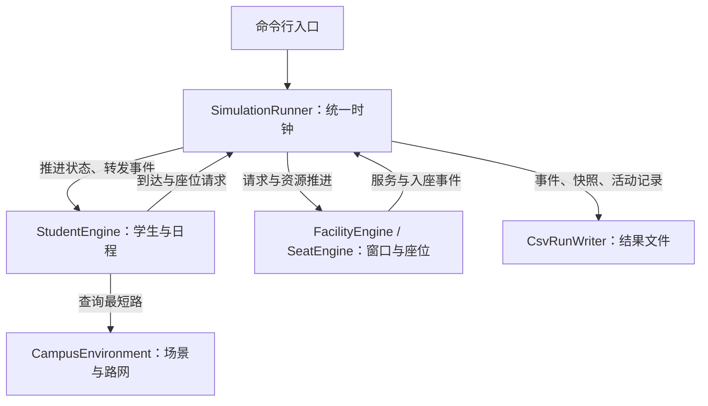

# CampusTwin Lite

**C++17 校园出行、活动与服务仿真。** 配置校园地图、学生和日程后，程序在同一时间轴上计算出行、选食堂、排队、取餐、等座及后续活动，输出可复核的 CSV 和离线实验报告。

例如，一名学生上午上课后选择食堂，沿最短路径前往；窗口排队和等座使午餐推迟，进而影响下午上课、图书馆学习和回宿舍的时间。修改道路、窗口或座位后，可以用相同学生配置对比结果。

当前包含五套合成校园场景。完整日程样例有 **16 个地点、38 条道路、3 个食堂、9 个窗口、36 名学生和 216 项活动**；同时保留原始 20 人午餐基准。主程序为命令行应用，报告使用浏览器离线查看。

## 项目架构



这是单进程、单线程、按整数分钟推进的仿真。模块通过 [公共契约](include/campustwin/contracts.hpp) 中的接口和事件连接；CSV 用于输入与输出，运行中的反馈通过内存调用传递。

每分钟先冻结上一分钟的服务状态，完成到期取餐、释放到期座位，再推进学生、分配窗口和座位，最后校验人数与资源状态并记录结果。调度器负责调用顺序，业务状态由对应引擎管理。

## 模块设计

| 模块与入口 | 主要设计 | 对外提供什么 |
| --- | --- | --- |
| [校园环境](include/campustwin/environment.hpp) `CampusEnvironment` | 加载、校验和保存场景；用无向加权图表示道路，Dijkstra 计算最短距离 | 只读 `CampusScenario`、包含可达性/距离/路径的 `RouteInfo` |
| [学生引擎](include/campustwin/students.hpp) `StudentEngine` | 分离静态配置与运行状态；按日程序列、时间和外部事件转换状态 | 服务到达、座位请求、决策记录、学生快照和活动记录 |
| [窗口服务](include/campustwin/resources.hpp) `FacilityEngine` | 每个食堂一条等待队列；窗口具有餐品兼容规则与独立服务时长 | 开始/完成事件、只读等待预测、队列及窗口统计 |
| [座位服务](include/campustwin/seats.hpp) `SeatEngine` | 每个地点独立 FIFO 座位池；到期释放，同分钟可重新分配 | 入座事件、等待/占用人数、座位利用率 |
| [统一调度](include/campustwin/simulation.hpp) `SimulationRunner` | 唯一时钟，转发事件，每分钟检查学生状态与资源计数一致 | 一次完整、可重复的仿真运行 |
| [结果记录](include/campustwin/reporting.hpp) `CsvRunWriter` | 接收值对象，写入稳定格式的结果文件 | 基础五份 CSV；日程或有限座位模式共八份 CSV |

学生引擎只通过 `IRouteProvider` 查路线、通过 `IFacilityAdvisor` 获取决策视图；服务引擎通过事件通知学生，不能直接修改学生的位置或日程。取餐完成和开始吃饭分开：配置了有限座位时，还要等待 `SeatGranted`。

详细设计见 [架构与状态流](docs/02_ARCHITECTURE.md) 和 [调度调用顺序](docs/06_INTEGRATION.md)。

## 下载源码

使用 Git：

```bash
git clone https://github.com/3550625279-ux/campustwin-lite.git
cd campustwin-lite
```

也可以在仓库页面选择 **Code → Download ZIP**，解压后在包含 `CMakeLists.txt` 的目录打开终端。这里提供的是源码，需要先构建再运行。

已有 Git 副本时，在妥善保存本地改动后更新：

```bash
git switch main
git pull --ff-only origin main
```

以下命令均从仓库根目录执行。ZIP 下载的副本不支持 `git pull`，需要重新下载源码。

## 环境与构建

| 工具 | 要求与用途 |
| --- | --- |
| C++ 编译器 | 支持 C++17；Windows 可用 Visual Studio C++ 工具链或 MinGW-w64，Linux/macOS 可用 GCC/Clang |
| CMake | 3.16 或更新版本，生成构建工程 |
| Python | 3.9 或更新版本，运行测试和生成实验报告；无需额外 Python 包 |
| Git / Ninja | Git 用于克隆和更新；仅选择 Ninja 生成器时需要 Ninja |

C++ 运行库仅依赖标准库。先确认当前终端能找到编译器、CMake 和 Python，然后执行：

```bash
cmake -S . -B build -DCMAKE_BUILD_TYPE=Debug
cmake --build build --config Debug
ctest --test-dir build -C Debug --output-on-failure
```

当前 CTest 包含 **19 项检查**，覆盖模块行为、真实联调、异常输入、原 MVP 和各组对照实验。成功时显示 `100% tests passed`。只编译可在配置时加 `-DBUILD_TESTING=OFF`；此时不要求 Python，但不会执行验收，实验报告仍需要 Python。

| 构建方式 | 主程序常见路径 |
| --- | --- |
| Linux/macOS，普通 Ninja 或 Makefiles | `build/campustwin` |
| Windows，普通 Ninja 或 MinGW Makefiles | `build/campustwin.exe` |
| Windows，Visual Studio 或 Ninja Multi-Config，Debug | `build/Debug/campustwin.exe` |

单配置生成器使用配置阶段的 `CMAKE_BUILD_TYPE`；Visual Studio 等多配置生成器使用构建阶段的 `--config Debug`。切换生成器时用新的构建目录，避免旧缓存冲突。

## 运行与查看结果

### 一次运行全部实验

Linux/macOS，普通 Ninja 或 Makefiles：

```bash
python3 tools/run_all_stages.py --executable build/campustwin --output outputs/all_stages
```

Windows PowerShell，Visual Studio Debug：

```powershell
py -3 tools/run_all_stages.py --executable .\build\Debug\campustwin.exe --output .\outputs\all_stages
Start-Process .\outputs\all_stages\report.html
```

Windows 普通 Ninja/MinGW 构建时，将可执行路径改为 `.\build\campustwin.exe`。没有 `py` 启动器时，使用能够运行 Python 3.9+ 的 `python`。

完成后打开 `outputs/all_stages/report.html`。它汇总原 MVP 验收、窗口与步速、动态选食堂、异质窗口、日程与座位实验；子报告保留输入副本、原始 CSV、对照统计和对应图表。日程报告可以切换学生和方案，查看活动时间线及实际路径的拓扑示意。

**实验输出目录必须尚不存在**；重复运行可改为 `outputs/all_stages_2`。单次仿真也拒绝覆盖同名结果文件。如果运行报错，已经产生的文件可能不完整，不能作为成功结果。

### 运行一份完整日程

```bash
./build/campustwin --scenario data/scenarios/campus_day --students data/students/campus_day.csv --schedule data/schedules/campus_day.csv --duration 160 --output outputs/campus_day
```

Windows 将 `./build/campustwin` 换成上表对应的 `.exe` 路径，其余参数相同。终端会报告 `36 students, 160 minutes; eight CSV files`；详细结果在输出目录内，单次仿真不会自动生成 HTML。

### 运行原始午餐基准

```bash
./build/campustwin --scenario data/scenarios/mvp --students data/students/mvp.csv --duration 120 --output outputs/mvp
python3 tests/check_mvp_outputs.py outputs/mvp
```

Windows 的校验命令使用 `py -3 tests/check_mvp_outputs.py outputs/mvp`。检查器只适用于原始 20 人、120 分钟样例；修改学生或资源后，应按新场景分析结果，不能继续套用固定基准的精确数值。

### 只查询路线

```bash
./build/campustwin --scenario data/scenarios/two_canteens --route L_T1 L_FAR
```

返回 `L_T1 → L_LIBRARY → L_FAR`，总距离 240 米。`--route` 为独立查询模式，不能与学生、日程、时长等仿真参数混用。

### 命令行参数

| 参数 | 含义 | 默认值 |
| --- | --- | --- |
| `--scenario DIR` | 校园配置目录 | `data/scenarios/mvp` |
| `--students FILE` | 学生配置 | `data/students/mvp.csv` |
| `--schedule FILE` | 可选的有序活动日程 | 不使用，执行午餐与返程 |
| `--policy fixed\|nearest\|fastest` | 覆盖全部学生的选食堂策略 | 使用学生文件中的策略，旧格式为固定食堂 |
| `--duration MINUTES` | 正整数仿真时长 | `120` |
| `--output DIR` | 结果目录 | `outputs/mvp` |
| `--route FROM TO` | 查询两个地点间最短距离与路线 | 不启用 |
| `--help` | 显示帮助 | — |

## 修改地图、学生和服务配置

建议先复制样例，再修改副本并通过命令行指向新文件。一次仿真加载一个校园目录；“多地图对照”通过分别运行不同目录实现。

| 输入文件 | 配置内容 |
| --- | --- |
| `locations.csv` | 地点 ID、名称、类型、描述容量；支持教学楼、食堂、宿舍、图书馆 |
| `roads.csv` | 无向道路的两端与距离，决定可达性和最短路 |
| `facilities.csv` | 食堂绑定地点、窗口数量和默认取餐时长 |
| `window_services.csv`（可选） | 各窗口支持的餐品及服务时长 |
| `seats.csv`（可选） | 地点的有限座位池；未配置的地点没有座位容量限制 |
| 学生 CSV | 初始地点、速度、午餐策略、餐品需求和旧午餐参数 |
| 日程 CSV（可选） | 每位学生有序的上课、午餐、学习、休息活动 |

地点 ID、设施 ID、学生 ID 必须相互对应。`locations.csv.capacity` 只是描述字段，实际占座限制由 `seats.csv` 启用。详细字段见 [基础数据格式](docs/05_DATA_FORMAT.md)、[窗口餐品配置](docs/15_COMPLEX_SERVICES.md) 和 [日程及座位配置](docs/16_ACTIVITY_SCHEDULES.md)。

## 输出与实验

| 输出文件 | 内容 |
| --- | --- |
| `events.csv` | 到达食堂、开始和完成取餐事件 |
| `student_snapshots.csv` | 每分钟学生状态、地点或移动计划 |
| `facility_snapshots.csv` | 每分钟队列、窗口占用与累计统计 |
| `summary.csv` | 每个食堂的等待、完成数和利用率等汇总 |
| `decisions.csv` | 选食堂时各候选的路径、预计耗时与选择结果 |
| `activities.csv` | 日程模式的计划和实际时刻、延迟、路径与完成状态 |
| `seat_events.csv` | 有限座位的请求和入座事件 |
| `seat_snapshots.csv` | 每分钟座位等待、占用和资源统计 |

最后三份在配置日程或有限座位时生成。食堂的 `completed` 只表示完成窗口取餐；学生是否完成全部活动，应查看最终学生快照和活动记录。

各实验也可以独立运行。命令格式为 `python3 tools/脚本名 --executable build/campustwin --output 新目录`，Windows 替换 Python 命令和程序路径。

| 脚本 | 对比的问题 |
| --- | --- |
| `run_lunch_experiments.py` | 同一批学生下，增加窗口或提高步速有什么影响？ |
| `run_dynamic_experiments.py` | 固定、最近、预计最快三种食堂策略如何改变队列？ |
| `run_service_experiments.py` | 相同窗口数下，专用窗口与通用窗口如何影响等待？ |
| `run_schedule_experiments.py` | 食堂/图书馆座位翻倍、封闭三条道路如何影响完整日程？ |

完整日程默认样例中，36 人的 216 项活动全部完成；只将图书馆座位翻倍后，总座位等待从 885 降到 357 分钟，全部完成时刻从第 124 分钟提前到第 94 分钟。它只说明这组合成输入的结果，不代表真实校园结论。

## 代码目录

| 路径 | 用途 |
| --- | --- |
| `app/main.cpp` | 解析命令行、加载配置、创建并连接各模块 |
| `include/campustwin/` | 公共数据契约和各模块声明 |
| `src/environment/` | 校园图、场景读写与本地账号实现 |
| `src/students/` | 学生输入、动态决策、日程与状态转换 |
| `src/resources/` | 窗口和座位两个资源引擎 |
| `src/simulation/`、`src/reporting/` | 调度与一致性校验、结果记录 |
| `data/`、`tests/` | 合成场景与手算参考、自动验收 |
| `tools/`、`examples/` | 实验报告脚本、模块独立演示 |
| `docs/`、`.github/` | 设计和使用文档、Linux/Windows 持续集成 |

源码阅读顺序和头文件对应关系见 [代码导览](docs/00_REPOSITORY_GUIDE.md)。`demo_a` 提供本地账号与场景编辑，`demo_b` 和 `demo_c` 提供独立行为演示；统一仿真 CLI 不要求登录。

## 当前模型边界

- 路径目标是最短距离，移动耗时为 `ceil(距离 / 步速)`；不模拟道路拥堵、自行车、校车或途中动态封路。
- `fastest` 在出发时使用上一分钟的冻结窗口状态，估计到完成取餐的耗时；不预测未来到达者或座位等待，途中不重新选食堂。
- 日程每人恰好一次午餐，可以包含多次上课、学习和休息。活动延迟会向后传递，当前不会自动取消活动、跨日循环或安排多餐。
- 报告中的地图是路径拓扑示意，没有真实地理坐标或实时人物动画。所有样例均为合成数据。

## 文档入口

| 需要了解什么 | 文档 |
| --- | --- |
| 源码、依赖与一次运行的数据流 | [代码导览](docs/00_REPOSITORY_GUIDE.md)、[架构设计](docs/02_ARCHITECTURE.md)、[调度流程](docs/06_INTEGRATION.md) |
| 公共类型与 CSV 约定 | [接口契约](docs/04_API_CONTRACT.md)、[数据格式](docs/05_DATA_FORMAT.md) |
| 场景编辑和本地账号 | [环境管理使用说明](docs/A_DELIVERY.md) |
| 动态选食堂、餐品窗口和多活动配置 | [选食堂](docs/14_DYNAMIC_LUNCH.md)、[窗口服务](docs/15_COMPLEX_SERVICES.md)、[活动与座位](docs/16_ACTIVITY_SCHEDULES.md) |
| 测试范围与原始手算基准 | [测试说明](tests/README.md)、[原 MVP 验收](docs/07_ACCEPTANCE.md) |
| 团队开发与协作 | [团队协作手册](docs/TEAM_GUIDE.md) |
