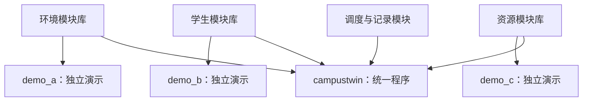

# 仓库结构详细讲解

这份导览回答四件事：为什么有这些目录；一条行为链怎样经过各模块；每个人具体改哪里；独立实现怎样成为同一个程序。它配合编号设计文档阅读，不替代接口契约。

## 一、先把“业务模块”和“运行入口”分开

A/B/C 的主要实现分别放在 `src/environment/`、`src/students/`、`src/resources/`。这些文件被编译成模块库，库本身不定义 `main`。

`examples/demo_a.cpp` 等文件分别定义独立演示的 `main`，方便一个成员在队友未完成时验证自己的模块。`app/main.cpp` 则定义最终集成程序的 `main`。

因此不是三个人先写三个成品程序再复制到一起，而是三个人开发三个能被共同调用的模块；每个模块同时有独立演示入口，最后再由统一入口使用。

## 二、每层目录解决什么问题

| 路径 | 是什么 | 为什么存在 | 谁主要维护 |
| --- | --- | --- | --- |
| `README.md` | 仓库首页与导航 | 让第一次进入的人知道目标、状态和阅读路径 | 全组 |
| `START_HERE.md` | 成员开工步骤 | 把“资料很多”变成具体阅读、构建和首次提交动作 | 全组 |
| `REVIEW.md` | 初始设计选择和团队待确认项 | 保留决策依据，不把草案当作已冻结协议 | 全组 |
| `CONTRIBUTING.md` | Git 协作方法 | 避免各自提交后无法同步、审阅或合并 | 全组 |
| `include/campustwin/` | 对外声明与公共类型 | 提前约定能调用什么，不暴露其他人的可变内部状态 | 各模块；公共协议共同评审 |
| `src/` | 各模块 `.cpp` 实现 | 存放真正算法和私有业务逻辑 | 各模块 |
| `app/` | 最终应用入口 | 解析用户输入、创建模块、调用统一运行器 | A |
| `examples/` | 三个独立演示入口 | 队友没完成时也能证明自己的功能可用 | A/B/C 对应维护 |
| `data/` | 输入与手算测试参考 | 开发者使用同一份可复现基准 | A 场景、B 学生、C 资源用例 |
| `tests/` | 样例校验与输出验收 | 检查约定，而不是凭屏幕看起来合理就通过 | 全组 |
| `docs/` | 设计、契约、验收、计划和周记 | 解释代码必须满足的行为与判断依据 | 全组 |
| `.github/` | 自动构建、Issue/PR 模板 | 提交后共同检查编译和协作信息是否完整 | A 维护构建，全组使用 |
| `CMakeLists.txt` | 统一构建规则 | 告诉工具哪些源文件组成哪些库和程序 | A，涉及其他模块时共同确认 |
| `.gitignore` | 本机产物的忽略规则 | 防止编译文件、输出结果和个人配置混入源代码 | 全组 |
| `.gitattributes` | 文本换行规则 | 降低不同操作系统造成的无意义文本差异 | A |

`build/` 和 `outputs/` 由本机构建/运行时产生，初始仓库不需要放这两个目录的成品文件。用户应该能从源码重新生成它们。

## 三、头文件与实现一一对应

| 公共声明 | 对应实现 | 内容 |
| --- | --- | --- |
| `contracts.hpp` | 不单独对应业务 `.cpp` | 时间/ID、输入数据、事件、快照和抽象接口 |
| `environment.hpp` | `src/environment/environment.cpp` | `CampusEnvironment`：场景与路径 |
| `students.hpp` | `src/students/students.cpp` | `StudentEngine` 和学生 CSV 读取 |
| `resources.hpp` | `src/resources/resources.cpp` | `FacilityEngine`：队列、窗口、统计 |
| `reporting.hpp` | `src/reporting/reporting.cpp` | `CsvRunWriter`：四份结果文件 |
| `simulation.hpp` | `src/simulation/simulation.cpp` | `SimulationRunner`：固定时钟与调用顺序 |
| `not_implemented.hpp` | 仅占位辅助 | 抛出带责任角色的未实现提示，避免空函数假装成功 |

`.hpp` 让别人知道“可以怎样调用”；`.cpp` 负责“内部具体怎样做”。成员可以往自己的具体类增加私有字段、辅助函数或更多源文件；新建 `.cpp` 时，要把它加进相应 CMake 模块目标，不能只放进目录就认为一定会被编译。

初始 CMake 每个模块只列一个源文件。后续例如将 A 拆成 `graph.cpp`、`scenario_csv.cpp`，应明确加入 `campustwin_environment` 的源文件列表；不要新建第二套根工程来绕开统一构建。

## 四、为什么所有人共用 contracts.hpp

B 产生“某学生在 t 分钟到达某食堂”，C 需要读懂它。若 B 叫 student_id、C 叫 user_id，或 B 用秒、C 用分钟，即使各自程序都能跑，也不能正确联调。

`contracts.hpp` 是共同的数据与接口协议。它把这类约定变成可编译的结构体和纯虚接口；文字含义仍由 [04_API_CONTRACT.md](04_API_CONTRACT.md) 补齐。

| 类型 | 传递的内容 | 所有权 / 产生方 |
| --- | --- | --- |
| `CampusScenario` | 地点、道路、静态设施参数 | A |
| `RouteInfo` | 是否可达、距离、路径 | A 查询结果 |
| `StudentSpec` | 学生初始位置、午餐目标、速度与日程 | B 读取输入 |
| `StudentArrival` | 一个确定的服务请求到达设施 | B |
| `ServiceStarted` | 哪个请求在什么窗口开始服务 | C |
| `ServiceCompleted` | 哪个请求在何时完成取餐 | C |
| `StudentSnapshot` | 一个学生在某分钟的状态 | B |
| `FacilitySnapshot/FacilitySummary` | 队列、窗口、完成、等待等 | C |

这些对象是描述和通知，不授权修改其他模块的私有容器。B 收到完成通知后更新自己管理的学生；C 不拿 B 的内部指针直接改学生状态。

## 五、沿 S001 的一顿午餐看完整流程

这是固定样例中 S001 的实际轨迹，完整程序会通过三模块交互产生它。

| 时刻 | 发生什么 | 哪个模块作决定 | 对外交互 |
| --- | --- | --- | --- |
| 启动 | 加载道路、设施和学生，检查引用关系 | A 读场景，B 读学生 | 有效场景与配置交给各模块初始化 |
| t=0 | S001 下课，去指定食堂 | B | 向 A 查询 120 m，速度 60 m/min，计算 t=2 到达 |
| t=2 | 学生到达食堂 | B | 发 `StudentArrival`，自身先变为 Queued |
| t=2 | 有空闲窗口，S001 开始取餐 | C | 发 `ServiceStarted`，B 再变为 InService |
| t=4 | 2 分钟服务到期 | C | 释放窗口，发 `ServiceCompleted`；B 变为 Eating |
| t=9 | 吃饭 5 分钟结束，回宿舍 | B | 向 A 查 120 m，再计算 2 分钟出行 |
| t=11 | 到达宿舍，午餐链结束 | B | 状态变为 Finished |

每个分钟的“先处理什么”由 Runner 固定：完成 → B 更新与到达 → C 入队 → 开始 → 快照。Runner 不替 A 算路径、不替 B 决策、不替 C 排队。

## 六、输入、反馈和输出不能混淆

| 类别 | 用什么表示 | 何时使用 |
| --- | --- | --- |
| 初始输入 | 场景/学生 CSV | 启动时读取 |
| 运行反馈 | 内存中的事件与函数调用 | 每分钟 B/C 相互影响时 |
| 观察结果 | 四份输出 CSV | 阶段末记录、运行后分析 |

不能简单做成“A 先导出文件，B 算完导出文件，C 最后读文件”这样的单向流水线，因为 C 的真实完成时间会决定 B 后续什么时候吃饭和离开。

`data/fixtures/` 下的 expected 文件是手算参考，不是程序要直接复制的运行结果。实际结果由 `CsvRunWriter` 写到用户指定的新目录，格式见 [05_DATA_FORMAT.md](05_DATA_FORMAT.md)。

## 七、tests 和 CI 到底证明了什么

| 检查 | 如何运行 | 能证明的事 | 不能证明的事 |
| --- | --- | --- | --- |
| C++ 编译链接 | `cmake --build` | 公共声明和具体类签名能一起构建 | 队列、移动已经正确实现 |
| `validate_sample_data.py` | CTest | 固定样例的字段、引用、参数与手算参考匹配 | C++ 业务真的运行过 |
| `check_mvp_outputs.py` | 对真实输出运行，集成测试也会调用 | 20 人固定场景的事件、状态、等待等符合基准 | 所有新场景或所有错误输入都正确 |
| `.github/workflows/build.yml` | push / PR 后触发 | 远端执行成功后，说明对应机器上的构建和 CTest 成功 | 没运行 workflow 时不能说 Windows 已验证；绿色不等于课程全部要求完成 |

CTest 已包含独立模块边界测试和真实仿真输出检查，具体范围见 [tests/README.md](../tests/README.md)。

## 八、按角色找到自己的最短阅读和修改路径

| 角色 | 最短阅读路径 | 第一次改动范围 | 接入时必须对齐 |
| --- | --- | --- | --- |
| A | MVP → 任务书 A → 数据格式 → 接口 A → 集成 | environment 头/源、demo_a、场景测试 | 场景生命周期、路程单位、Runner 阶段顺序 |
| B | MVP → 任务书 B → 状态机 → 接口 B → 学生 CSV | students 头/源、demo_b、学生测试 | 请求唯一、开始/完成反馈、在途不占地点 |
| C | MVP → 任务书 C → 接口 C → 3 人样例 → 输出 | resources/reporting 头/源、demo_c、服务测试 | 旧队列优先、窗口编号、等待与利用率分母 |

`docs/planning/INITIAL_ISSUES.md` 提供可认领的小任务草稿；`docs/weekly/TEMPLATE.md` 帮每人留下实际开发记录。任务书里的责任是工作边界，具体名字和联调日期由团队确认。

## 九、常见卡点

| 现象 | 先检查什么 |
| --- | --- |
| 找不到 CSV | 是否从仓库根目录运行；场景目录与学生文件参数是否正确 |
| 已写新 `.cpp`，但编译时没出现 | 相应模块目标有没有加入该源文件 |
| duplicate main / 重复入口 | 有没有把 demo 的 main 混进模块库或最终 app |
| undefined reference / 缺少实现 | 声明与定义签名是否一致，源文件是否被编译，对应库是否链接 |
| 仍报 NOT_IMPLEMENTED | 是否只完成了部分函数；实际调用链还有哪个明确占位未替换 |
| 学生服务完不离开 | C 是否发完成事件；Runner 是否转给 B；B 是否正确设置就餐结束时刻 |
| 排队统计与学生状态对不上 | B 是否收到开始事件；是否把 Eating 计入窗口服务；是否在统一阶段末取快照 |

完整编译、提交、PR 和冲突处理操作见 [CONTRIBUTING.md](../CONTRIBUTING.md)。当问题涉及公共字段或单位时，先修协议与调用方，再继续各自实现。
