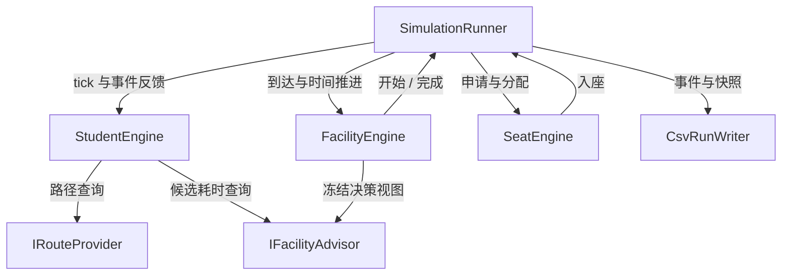

# 当前架构与模块设计

系统是 C++17 单进程、单线程的分钟级仿真。三类业务分别是校园环境、学生行为、资源服务；资源服务内再区分窗口与座位。统一运行器负责时钟和事件路由，记录器负责输出。

## 模块关系与所有权

| 数据 | 唯一修改者 | 其他部分怎样使用 |
| --- | --- | --- |
| 地点、道路、设施与座位静态配置 | `CampusEnvironment` | 初始化时读取，一次运行中不改地图 |
| 学生位置、移动、选择与活动进度 | `StudentEngine` | 通过快照观察，通过事件通知其自行更新 |
| 窗口队列、服务状态和取餐统计 | `FacilityEngine` | 通过冻结视图预测，通过快照统计 |
| 座位等待、占用和释放 | `SeatEngine` | 通过入座事件和座位快照交互 |
| 当前仿真分钟与调用顺序 | `SimulationRunner` | 以 `now` 参数传给各模块 |
| 输出文件 | `CsvRunWriter` | 只接受值对象，不修改业务状态 |

`contracts.hpp` 是唯一共享协议。`StudentEngine` 依赖 `IRouteProvider`、`IFacilityAdvisor`，不读取具体环境或服务类的私有状态。Runner 通过 `IStudentEngine`、`IFacilityEngine`、`ISeatEngine`、`IRunWriter` 调用具体实现。接口带虚析构，独立测试可以注入替身。

## 环境：图与配置一致性

地点是节点，道路是带距离权重的无向边。`CampusEnvironment` 加载配置、检查引用并构造邻接表；Dijkstra 返回可达性、最短距离和节点路径。同点路径距离为 0，不可达返回明确结果。路线目标是距离，学生再根据个人步速计算 `ceil(距离 / 速度)`。

场景替换先校验完整副本再接纳；非法输入不能污染已加载场景。地点描述容量与有限座位池分开，只有 `seats.csv` 启用座位约束。多地图通过选择不同场景目录运行，封路实验修改输入副本，不在仿真中途更改道路。

## 学生：配置、状态与触发

`StudentSpec` 保存输入；私有 `StudentRuntime` 保存当前状态、移动计划、已选食堂、活动索引、服务与座位信息。时间触发发生在 `tick`，服务/入座反馈分别通过事件处理函数触发，所有状态最终由学生引擎修改。

| 状态 | 含义 | 主要退出条件 |
| --- | --- | --- |
| `AtLocation` | 位于地点，等待出发或活动计划时刻 | 达到出发/开始时间 |
| `Moving` | 正在一段移动中，记录起点、终点和到达时刻 | 到达后进入相应活动或等待 |
| `Queued` | 已请求食堂窗口服务 | 收到 `ServiceStarted` |
| `InService` | 正在窗口取餐 | 收到 `ServiceCompleted` |
| `WaitingSeat` | 等待食堂或学习地点的座位 | 收到 `SeatGranted` |
| `Eating` | 正在吃饭，可能持有食堂座位 | 用餐计时结束 |
| `InActivity` | 正在上课、学习或休息 | 活动计时结束 |
| `Finished` | 该学生的完整行为链已结束 | 终态 |

`Moving` 时不占起点或终点；其余状态有明确地点。取餐结束后，无座位约束时可立即开始吃饭，有约束时先等座。

有序日程包含恰好一次午餐和若干普通活动。普通活动尽量在计划开始前按路程提前出发，到早了等待，到晚了执行完整时长；前项延迟传递到后项，不抢占当前活动。午餐的计划时刻是最早出发时刻。无日程时保留午餐后自动返回的兼容行为。

选食堂支持固定、最近、预计最快。预计最快综合路程、冻结队列和餐品兼容窗口的预计服务结束时间；不预测未来到达者、座位等待或课程约束，也不在路上重选。详见 [动态选择](14_DYNAMIC_LUNCH.md)。

## 服务：窗口与座位分别调度

`FacilityEngine` 每个食堂维护一条队列和多个窗口。旧等待者在新请求之前，同分钟新到者按学生 ID 排序。匹配按队列先后处理请求，用增广路径尽量利用更多兼容的空闲窗口：可以把本分钟已匹配的早到者换到另一个兼容窗口，但不会挤掉他。窗口编号用于确定性破同分；不兼容队首不会阻塞后面的可服务者。这不优化全局等待或服务时长，也不是所有餐品统一严格 FIFO。

窗口按自己的服务时长安排结束，产生开始/完成事件。`decision_snapshot()` 产生独立只读视图，使同一分钟的所有学生看到相同的上分钟状态，避免学生遍历顺序改变观察条件。

`SeatEngine` 按地点独立管理有限容量、FIFO 等待队列和占用到期时间。同一学生不能同时等候或占据两个座位池。占用采用 `[开始,结束)`，在结束分钟先释放，再处理新申请和分配；空出的座位可以同分钟复用。

窗口与座位相互独立。取餐结束即释放窗口，等待座位不继续占窗口；学生收到入座事件才进入需要座位的活动。细节见 [餐品服务](15_COMPLEX_SERVICES.md) 与 [日程和座位](16_ACTIVITY_SCHEDULES.md)。

## 调度与可观察性

Runner 在 `0..duration` 每分钟执行：冻结决策视图 → 完成取餐 → 释放座位 → 学生推进 → 窗口入队/开始 → 座位入队/分配 → 守恒校验 → 输出。完整调用顺序见 [调度说明](06_INTEGRATION.md)。

每分钟检查：窗口排队数等于学生 `Queued` 数，窗口占用数等于 `InService` 数；座位等待与占用数也必须对应学生快照，且不能超过容量。排序与请求唯一性使结果不受输入行或哈希容器遍历顺序影响。

基础模式输出五份 CSV；日程或有限座位模式增加活动、座位事件和座位快照，共八份。仿真截止时未完成的活动保留未完成状态，统计按实际观察区间计算，不能将取餐完成数当成完整日程完成数。

## 扩展接口的位置

| 变化 | 主要落点 | 需要保持或共同迁移的语义 |
| --- | --- | --- |
| 路由算法、地图规则 | 环境与 `IRouteProvider` | 返回路径含义、距离/时间单位 |
| 学生偏好、活动计划 | 学生引擎与输入校验 | 状态与事件时序、决策记录 |
| 服务匹配、座位策略 | 资源引擎 | 公平性、请求唯一性、释放时刻与统计 |
| 新输入或结果字段 | 契约、加载器、记录器、报告 | 旧格式兼容与对应测试 |
| 更细时间粒度 | 整体公共契约 | 不可局部把分钟改成秒 |

成员责任和提交流程仅在 [团队协作手册](TEAM_GUIDE.md) 维护。
