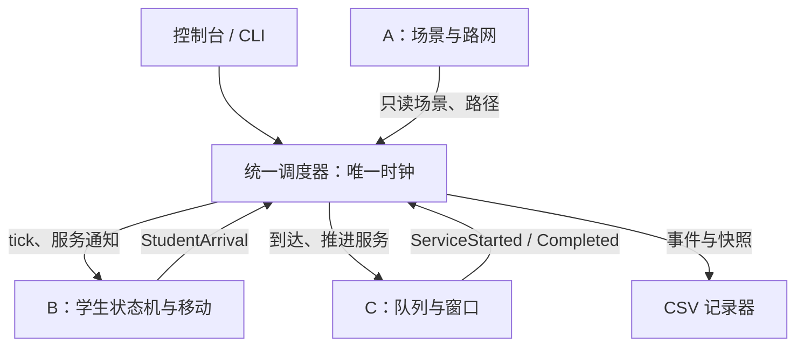
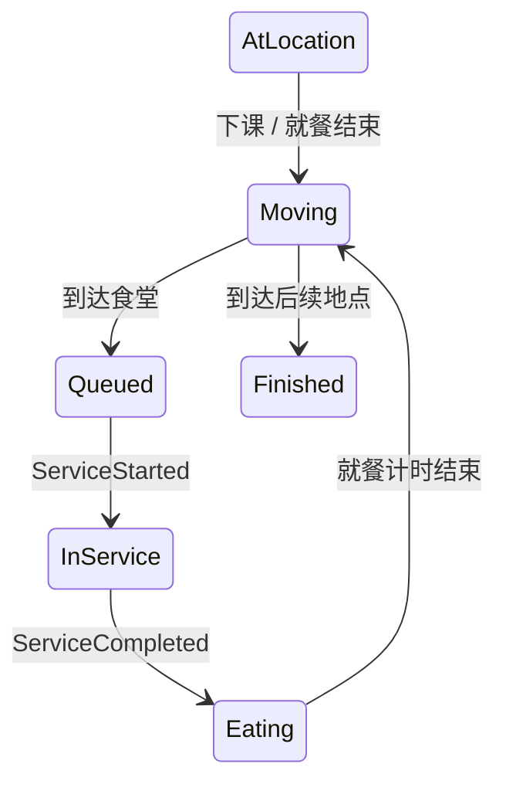

# 架构设计

## 一个进程，三个业务模块

调度器只安排调用顺序和传递事件。路线怎么找由 A 决定，学生去哪和何时移动由 B 决定，谁排队和窗口何时释放由 C 决定。

## 所有权和依赖

| 数据 | 唯一修改者 | 其他模块怎样使用 |
| --- | --- | --- |
| 地点、道路、设施静态配置 | A | 启动时读取；一次运行中不修改 |
| 学生位置、日程、移动、主要状态 | B | 调度器读取快照；C 只发事件 |
| 请求队列、窗口、服务统计 | C | 调度器读取快照；B 只接事件 |
| 当前仿真分钟 | 调度器 | 所有更新通过 `now` 参数获知 |
| 输出文件 | 记录器（C 维护） | 接收值对象并写入，不修改业务状态 |

B 只依赖 `IRouteProvider`，不依赖 A 的具体场景类；C 不依赖 B 的类。所有模块引用同一份 `contracts.hpp`，不得再复制一套公共 `Student`、`Time` 或事件类型。

## 状态机

`Moving` 不占用起点或终点人数；其他状态在且只在一个地点。食堂中的人数包含 `Queued + InService + Eating`。窗口服务完成仅代表取餐完成，B 再决定就餐时长和下一次出行。

## 最少的继承与多态

公共协议提供两层结构：抽象接口 → 具体实现，例如 `IRouteProvider → ICampusEnvironment → CampusEnvironment`；`IStudentEngine → StudentEngine`；`IFacilityEngine → FacilityEngine`。虚析构保证通过接口指针释放正确，调度器通过接口引用调用，构成实际多态使用。

这只是工程边界，不等于已经满足老师对“类层次”的所有理解。原分工转述了至少两层以上类层次，未附课程原文；三人应核对是否还要求业务继承。后续有真实差异时可引入 `Activity` 的移动/就餐派生类，或 `Facility` 的食堂/座位设施派生类；首版不为了层数复制无差异类。

## 一致性规则

1. 一个请求对应一次到达、一次开始、一次完成；MVP 每个学生仅一个午餐请求。
2. B 在到达时设为 `Queued`，收到开始事件才设为 `InService`；C 不直接访问 B 容器。
3. `C.queue_length` 等于该设施在 B 中的 `Queued` 数量，`C.in_service` 等于 B 的 `InService` 数量。
4. 每个窗口至多处理一个请求，已完成请求不会重新入队。
5. 同一输入不得因哈希表遍历顺序不同改变结果；对外事件和快照明确排序。

## 扩展落点

| 后续功能 | 修改位置 | 首版接口的准备 |
| --- | --- | --- |
| 更换最短路算法 | A 的私有实现 | B 只拿 `RouteInfo` |
| 不同日程与偏好 | B 的活动决策 | C 不接触日程 |
| 不同设施服务规则 | C 的设施实现 | B 只接收服务事件 |
| 拥堵感知选食堂 | B + C，先提交接口变更 | 新增只读查询，禁止直接读 C 私有队列 |
| 更细时间粒度 | 修改公共契约并共同迁移 | 当前分钟整数是明确的首版限制，不能静默改单位 |

首版用直接函数调用传递事件向量即可，不需要通用消息总线、线程池或网络消息系统。
