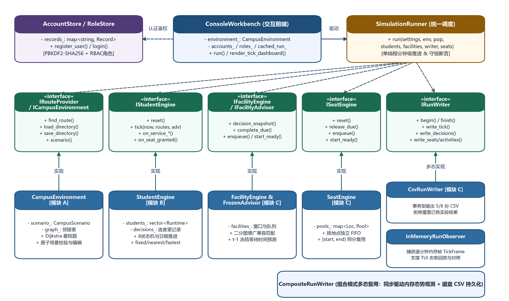
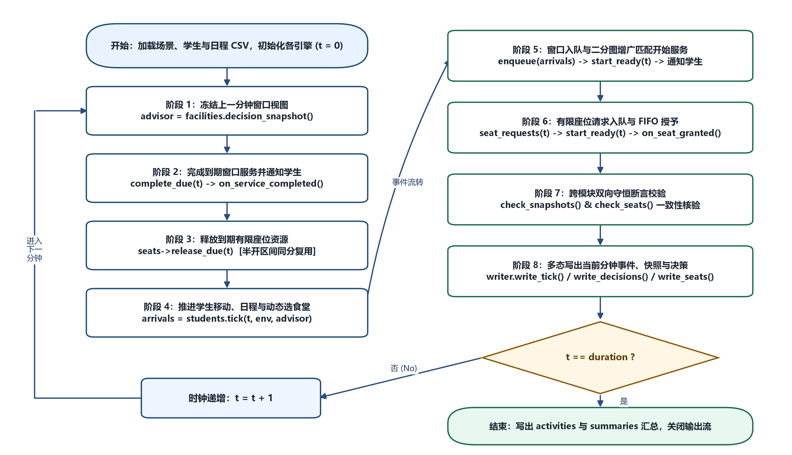
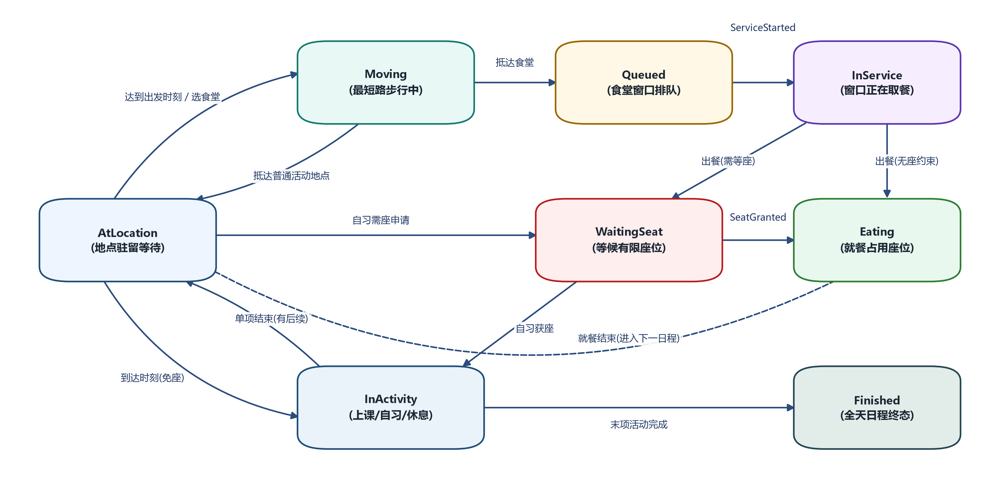
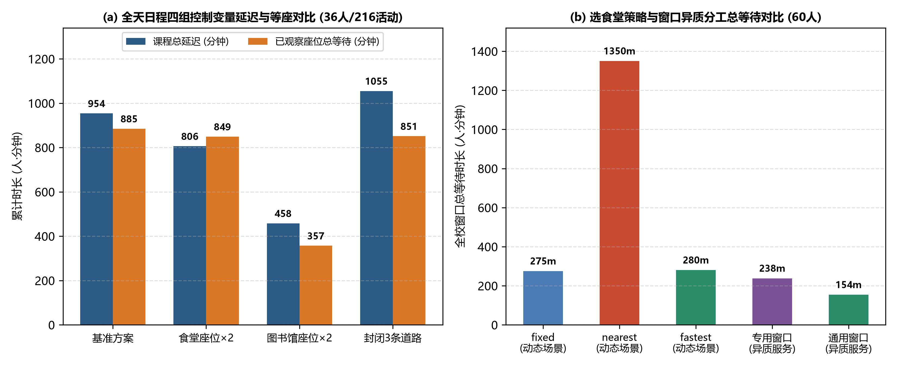

# 华南理工大学《面向对象程序设计》课程设计报告书

> **排版与打印核对提示**：同目录下的 [`课程设计报告书_CampusTwin_Lite.docx`](./课程设计报告书_CampusTwin_Lite.docx) 已按《课程设计报告文档+意见模板-2026-AI拔尖班》完成标准字号与行距排版（封面二号黑体居中、课题三号宋体居中上下空一行、一级标题四号宋体加粗、正文小四号宋体首行缩进 2 字符且固定行距 20 磅、图号居下表号居上、公式右端括号编号无虚线、参考文献五号宋体顺序编码制）。打印前请将封面与评语页的 `[个人姓名/学号/队友姓名/个人主责模块]` 替换为本人实际信息，并按学院要求采用 210g/m² 绿色封面纸装订。

---

## 封面信息与教师评语页（三角色裁剪模板）

- **题目**：基于 C++17 的校园出行、活动与服务数字孪生仿真系统（CampusTwin Lite）
- **学院**：计算机科学与工程学院
- **指导教师**：沃 焱
- **课程编号**：045101571（2 学分）
- **起始日期**：2026 年 9 月至 2026 年 12 月

### 教师评语页填写模板（按个人角色三选一）

- **【若你是模块 B 负责人（Edward / `3550625279-ux`）】**：
  > 该生与 XX、XX 同学完成了《基于 C++17 的校园出行、活动与服务数字孪生仿真系统（CampusTwin Lite）》的开发与设计，该系统包括：校园环境与路网导航模块、本地账号与角色权限模块、学生动态决策与多活动日程引擎、异质窗口与有限座位资源调度模块、统一时钟离散事件调度与守恒校验模块、多态结果记录与交互式命令行前端（TUI）模块。其中该生主要完成了 **学生与日程多版本 CSV 解析校验、`fixed/nearest/fastest` 拥堵感知动态选食堂决策、学生八状态有限自动机驱动、多活动有序日程延迟传播以及交互式命令行态势看板** 模块的设计及代码工作。
- **【若你是模块 A 负责人】**：
  > ……其中该生主要完成了 **校园无向加权路网建模与 Dijkstra 最短路导航、五类场景配置原子化校验与持久化、基于 PBKDF2-HMAC-SHA256 的本地账号与角色权限管理以及统一时钟调度集成** 模块的设计及代码工作。
- **【若你是模块 C 负责人】**：
  > ……其中该生主要完成了 **异质餐品窗口二分图增广路径匹配、`t-1` 冻结队列等待预测器、食堂与图书馆有限座位池 FIFO 调度及同分钟释放复用、多态事务型 CSV 结果记录器与对照实验统计** 模块的设计及代码工作。

---

## 基于 C++17 的校园出行、活动与服务数字孪生仿真系统

### 一、选题背景

高校校园是一个典型的多主体、多资源、强时序耦合的复杂服务系统$^{[1,2]}$。在日常教学运行中，学生需要在同一时间轴上依次完成上午上课、午间前往食堂就餐、下午课程、图书馆自习以及返回宿舍休息等一系列有序活动。教学楼与各食堂之间的路网拓扑距离、学生个体的选食堂策略、各食堂窗口的餐品兼容规则以及食堂与图书馆的有限座位容量相互叠加，使得某一环节的局部拥堵（如热门食堂排队或自习室等座）会沿着个人日程向后传播，进而引发后续课程迟到或全天活动推迟。

针对传统经验估算难以量化评估校园资源配置改动的痛点，本课题设计并实现了轻量级校园数字孪生离散事件仿真系统 **CampusTwin Lite**。系统基于标准 C++17 构建（零第三方运行库依赖），在统一分钟级时钟驱动下对校园路网最短路径导航、拥堵感知动态选食堂、异质窗口二分图增广匹配、食堂与图书馆有限座位池 FIFO 调度以及多活动日程延迟传播进行可复现仿真；同时配套了支持实时逐分钟态势回放、单人轨迹透视、内存控制变量对照实验、PBKDF2 本地账号角色权限管理与在线场景编辑的**命令行交互工作台（TUI）**，以及离线交互式 HTML 实验报告工具链。

**表1 小组成员模块职责与公共协作分工表**

| 角色模块 | 负责成员 | 核心业务职责与维护代码范围 | 公共工程与联调工作 |
| --- | --- | --- | --- |
| 模块 A：校园环境与安全 | `[待填成员A]` | 无向加权路网构建与 Dijkstra 最短路、5类场景 CSV 原子加载与保存、PBKDF2-SHA256 本地账号存储 (`environment`/`accounts`) | CMake 构建工程、`SimulationRunner` 统一时钟调度、跨模块守恒断言 |
| 模块 B：学生决策与日程 | `Edward (3550625279-ux)` | 学生与日程多格式校验、`fixed/nearest/fastest` 动态选食堂、8状态有限自动机、多活动日程与延迟传播 (`students`) | 核对逐分钟学生轨迹、决策快照语义与服务/入座事件闭环 |
| 模块 C：资源调度与输出 | `[待填成员C]` | 异质餐品窗口增广匹配、`t-1` 冻结等待预测、按地点 FIFO 有限座位池、事务型多态 CSV 记录器 (`resources`/`seats`/`reporting`) | 统一统计口径、手算基准核验、四阶段对照实验脚本 |
| 前端展示层：交互式 TUI | 全组协同 | 基于多态 `InMemoryRunObserver` 与 `CompositeRunWriter` 的命令行交互工作台、RBAC 权限门禁与实时态势看板 (`tui`) | 自动化回归测试集（20项 CTest）与课程答辩演示闭环 |

---

### 二、系统设计

#### 1、类体系设计

系统以 `include/campustwin/contracts.hpp` 作为唯一公共契约层，运用面向对象抽象接口（纯虚基类）、继承与运行期多态实现高内聚低耦合的层次化设计$^{[3,4]}$：

1. **校园环境与路由继承链**：`IRouteProvider`（最小只读路由契约 `find_route()`）← `ICampusEnvironment`（场景持久化契约）← `CampusEnvironment`（邻接表路网与在线编辑具体实现）。
2. **资源预测与服务引擎链**：`IFacilityAdvisor` ← `FrozenAdvisor`（`t-1` 冻结只读预测视图）；`IFacilityEngine` ← `FacilityEngine`（窗口队列与异质匹配）；`ISeatEngine` ← `SeatEngine`（按地点独立 FIFO 座位池）。
3. **学生行为状态机封装**：`IStudentEngine` ← `StudentEngine`，内部将只读输入规格 `StudentSpec` 与私有运行态 `StudentRuntime` 严格分离。
4. **输出与前端多态扩展链（开闭原则 + 组合模式）**：抽象接口 `IRunWriter` 派生出磁盘持久化类 `CsvRunWriter`、内存遥测捕获类 `InMemoryRunObserver` 与组合多路复用类 `CompositeRunWriter`，使 `SimulationRunner` 零代码改动即可同时驱动批处理 CSV 写出与 TUI 实时回放。

<b>图1 CampusTwin Lite 系统面向对象类体系与接口契约图</b>

#### 2、类的说明

**表2 系统核心类的数据成员与成员函数功能说明表**

| 类名（所属模块） | 关键私有数据成员 | 核心公有/私有成员函数及功能描述 |
| --- | --- | --- |
| `CampusEnvironment`（模块 A） | `scenario_`: `CampusScenario` 场景配置；`graph_`: 邻接表无向加权图 | `load_directory()`/`save_directory()`：校验并读写5份场景CSV；`replace_scenario()`：强异常安全重建路网；`find_route()`：Dijkstra 最短路与路径回溯；`add/remove_location`、`set/remove_road`：在线编辑 |
| `AccountStore` & `RoleStore`（模块 A/TUI） | `file_`: 路径；`records_`: 盐值与 PBKDF2 摘要表；`roles_`: 用户角色映射 | `register_user()`：128位随机盐、20万次 PBKDF2 派生与原子落盘；`login()`：常量时间摘要比对防侧信道；`role_of()`/`set_role()`：三级 RBAC 角色管理 |
| `StudentEngine`（模块 B） | `students_`: `vector<StudentRuntime>`；`student_indices_`: 学号索引；`decisions_`: 选食堂记录；`seat_requests_`: 座位申请缓冲 | `reset()`：校验学生与有序日程并按ID排序；`tick(now, routes, advisor)`：推进移动、日程与选食堂；`advance_schedule()`：计算提前出发并传播延迟；`on_service_*()`、`on_seat_granted()`：事件驱动转态 |
| `FacilityEngine`（模块 C） | `facilities_`: 各食堂队列与窗口槽位；`seen_requests_`/`active_students_`: 防重集；`phase_`: 阶段状态锁 | `decision_snapshot()`：构造 `t-1` 冻结预测视图；`complete_due()`：释放到期窗口；`enqueue()`：确定性排序入队；`start_ready()`：异质餐品二分图增广匹配 |
| `SeatEngine`（模块 C） | `pools_`: 各场所 FIFO 队列与占座列表；`seen_`/`present_`: 全局防双重占座；`phase_`: 时序锁 | `reset()`：初始化有限座位池；`release_due()`：按 `[at, until)` 半开区间释放到期座位供同分复用；`enqueue()`/`start_ready()`：FIFO 授予座位 |
| `SimulationRunner`（公共调度） | 无业务状态（纯薄调度器） | `run()`：推进统一时钟 `0..duration`，编排单分钟八阶段交互，调用 `check_snapshots()` 与 `check_seats()` 执行双向人数守恒校验 |
| `CsvRunWriter` / `InMemoryRunObserver` / `CompositeRunWriter` | 8路 `ofstream` 文件流；`run_`: `RecordedRun` 逐分钟内存态势帧；`writers_`: 子写入器指针数组 | 实现 `IRunWriter` 多态接口：拒绝覆盖旧文件、事务型写出 5/8 份 CSV，或在内存中捕获 `TickFrame` 支撑 TUI 动态看板与对照实验 |
| `ConsoleWorkbench`（交互前端 TUI） | `environment_`、`population_`、`cached_run_`、`accounts_`、`roles_`、`current_role_` | `run()`：主菜单交互循环；`render_tick_dashboard()`：渲染8状态守恒、窗口/座位进度条与事件流；支持单人日程透视、四组内存对照实验与管理员沙盒改图 |

#### 3、程序流程图

<b>图2 统一调度器单分钟八阶段离散事件推进与守恒校验流程图</b>

<b>图3 学生引擎八状态有限自动机与多活动日程流转图</b>

核心计算关系定义如下：

$$t_{\text{travel}}(u, v) = \max\left(1, \left\lceil \frac{d(u, v)}{v_{\text{walk}}} \right\rceil\right) \tag{1}$$

$$\hat{T}(f) = t_{\text{travel}}(f) + \hat{W}_{t-1}\big(f, t + t_{\text{travel}}(f), m\big) + t_{\text{service}}(f, m) \tag{2}$$

$$U = \frac{\sum_{t=0}^{T-1} n_{\text{busy}}(t)}{C \times T} \tag{3}$$

---

### 三、系统实现

1. **校园环境路网、原子化场景持久化与本地账号实现【模块 A】**：
   - 场景加载器对 UTF-8 编码合法性、无 BOM、字段边界与跨表引用完整性逐一校验，在局部副本构造完邻接表后再通过 `std::swap` 原子替换生效状态，保证异常零污染。
   - `find_route()` 使用最小堆 Dijkstra 与 `long double` 距离累加，配合按字典序预排的邻接表保证多最短路破平完全确定$^{[5]}$。
   - `AccountStore` 零外部依赖实现 FIPS 180-4 SHA-256、RFC 2104 HMAC 与 RFC 8018 PBKDF2（200,000 次迭代 + 128 位随机盐）$^{[6]}$，登录校验对未知用户同样执行完整 KDF 并使用按位异或常量时间摘要比较。
2. **学生引擎、冻结视图动态选食堂与多活动日程状态机实现【模块 B】**：
   - 兼容 7/8/9 列学生 CSV 与乱序日程 CSV，强制校验连续序号、唯一午餐及活动-地点类型匹配，并按学号排序消除文件行顺序偏差。
   - 出发时刻遍历全体食堂生成 `LunchDecision` 完整评估表，结合 `IFacilityAdvisor` 冻结快照执行 `fixed/nearest/fastest` 决策。
   - `advance_schedule()` 按 `planned_start - travel_minutes` 提前动身；前序排队或等座超时则紧接出发并向后传播延迟（`start_delay_minutes`），完整执行原定课程/自习时长。
3. **异质窗口增广匹配、有限座位复用与多态记录器实现【模块 C】**：
   - `assign_windows()` 针对多餐品兼容约束按 FIFO 顺序开展 BFS 增广路径搜索：可将本分钟刚预分配的早到者平移至另一兼容空闲窗口，既绝不剥夺早到者服务权，又消除专用窗口空置浪费。
   - `SeatEngine` 采用 `[at, until)` 半开区间管理占座，每分钟先 `release_due(t)` 再分配，支持同分钟无缝复用。`CsvRunWriter` 具备防覆盖保护与单分钟缓冲原子写入。
4. **统一时钟守恒校验与命令行交互式前端（TUI）实现【公共联调与前端】**：
   - `SimulationRunner` 每分钟自动核对 `StudentSnapshot` 与 `FacilitySnapshot`/`SeatSnapshot` 的排队及占用人数守恒。
   - `ConsoleWorkbench` 基于 UTF-8/ANSI 构建零依赖中文终端界面，包含预设切换、逐分钟动态看板（含拥堵峰值一键跳转）、个体甘特时间轴色带、四组内存对照实验、Dijkstra 距离矩阵与受 `Admin` 角色保护的在线沙盒场景编辑器。

---

### 四、结果分析

#### 1、设计测试用例

系统通过 CTest 组织 **20 项自动化回归测试**（涵盖手算 20 人 MVP 基准、RFC 密码学标准向量、畸形/乱序/超界/断路异常拦截、三阶段控制变量对照实验以及交互式 TUI 工作台与 RBAC 权限测试），执行结果 **20/20 全部通过（100% passed）**。

#### 2、程序测试结果

**表4 全天多活动日程四组控制变量实验实测结果对比表（36人，216项活动，160分钟）**

| 实验方案 | 完成学生 | 完成活动 | 迟到课程数 | 课程总延迟(分) | 已观察等座(分) | 总行程(米) | 全员完成时刻 |
| --- | :---: | :---: | :---: | :---: | :---: | :---: | :---: |
| 1. 基准方案 (Baseline) | 36 / 36 | 216 / 216 | 56 | 954 | 885 | 30240 | 第 124 分钟 |
| 2. 仅将食堂座位翻倍 (×2) | 36 / 36 | 216 / 216 | 50 | 806 | 849 | 30240 | 第 124 分钟 |
| 3. 仅将图书馆座位翻倍 (×2) | 36 / 36 | 216 / 216 | 50 | 458 | 357 | 30240 | **第 94 分钟** |
| 4. 封闭三条主干道路 | 36 / 36 | 216 / 216 | 58 | 1055 | 851 | 34800 | 第 127 分钟 |

**表5 动态选食堂策略与异质窗口分工控制变量实验实测结果汇总表（60人）**

| 所属实验组 | 对比方案 | 完成取餐 | 队列峰值 | 总等待(分) | 平均等待(分) | 流量分布与资源表现 |
| --- | --- | :---: | :---: | :---: | :---: | --- |
| 阶段一：选食堂策略 (`dynamic_campus`) | `fixed` (预设固定) | 60 / 60 | 16 | 275 | 4.58 | 远近食堂人工均分 30 : 30 |
| 阶段一：选食堂策略 (`dynamic_campus`) | `nearest` (唯距离最近) | 60 / 60 | 46 | 1350 | 22.50 | 60人全部涌向近食堂 (60 : 0) 严重拥堵 |
| 阶段一：选食堂策略 (`dynamic_campus`) | `fastest` (拥堵感知最快) | 60 / 60 | 16 | 280 | 4.67 | 自动感知排队并分流为 22 : 38，较 `nearest` 降等 **79.3%** |
| 阶段二：异质窗口 (`service_campus`) | 专用窗口 (1窗1餐品) | 60 / 60 | 21 | 238 | 3.97 | 单一餐品集中到达时出现“有窗闲、有人排” |
| 阶段二：异质窗口 (`service_campus`) | 通用窗口 (全餐品兼容) | 60 / 60 | 17 | 154 | 2.57 | 窗口总数不变，增广匹配降低总等待 **35.3%** |

<b>图4 全天日程四组控制变量实验与策略/窗口分工实验关键指标对比图</b>

#### 3、结果分析与结论

1. **反直觉瓶颈定位**：在 `campus_day` 中，食堂座位翻倍仅减少 36 分钟等座且无法提前结束时刻（仍为 124 分）；而图书馆座位翻倍使总等座下降 **59.7%**（885→357 分）、课程总延迟减半（954→458 分），全员完成提前 **30 分钟**（124→94 分），证明午后自习座位才是全链路核心瓶颈。
2. **封路与步速的时空耦合效应**：封闭 3 条道路后总行程增加 4560 米、课程总延迟升至 1055 分钟，但绕行拉开了到达时刻（被动错峰），使等座反而微降至 851 分钟；表明校园治理评估必须多指标联合审视。
3. **软策略替代硬扩建**：零硬件新增下，`fastest` 策略削减 79.3% 等待，通用窗口增广匹配削减 35.3% 等待。

---

### 五、课程设计总结

本次课设通过 `contracts.hpp` 契约隔离、多态 `IRunWriter` 扩展（`CsvRunWriter` / `InMemoryRunObserver` / `CompositeRunWriter`）、`t-1` 冻结快照以及每分钟双向守恒检查器，高质量完成了从单次午餐 MVP 到多活动数字孪生及命令行交互前端的演进。未来可进一步引入路段动态拥堵、自行车/校车多模态出行、含等座预测的联合效用决策以及真实校园 GIS 坐标动画渲染。

---

### 参考文献

- `[1]` Law A M. Simulation Modeling and Analysis [M]. 5th ed. New York: McGraw-Hill Education, 2015. 1-84.
- `[2]` Banks J, Carson J S, Nelson B L, et al. Discrete-Event System Simulation [M]. 5th ed. Upper Saddle River: Pearson, 2010. 45-112.
- `[3]` Stroustrup B. The C++ Programming Language [M]. 4th ed. Boston: Addison-Wesley Professional, 2013. 579-642.
- `[4]` Gamma E, Helm R, Johnson R, et al. 设计模式：可复用面向对象软件的基础 [M]. 李英军, 马晓星, 蔡敏, 等译. 北京: 机械工业出版社, 2007. 107-116.
- `[5]` Cormen T H, Leiserson C E, Rivest R L, et al. 算法导论 [M]. 原书第3版. 殷建平, 徐云, 王刚, 等译. 北京: 机械工业出版社, 2013. 379-386.
- `[6]` Moriarty K, Kaliski B, Jonsson J, et al. PKCS #5: Password-Based Cryptography Specification Version 2.1, RFC 8018 [EB/OL]. https://www.rfc-editor.org/rfc/rfc8018, 2017-01-20/2026-11-18.
