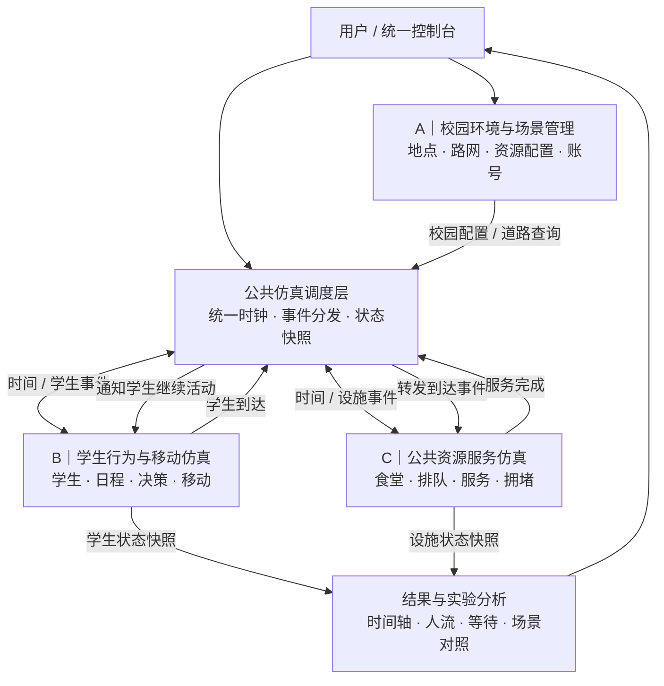
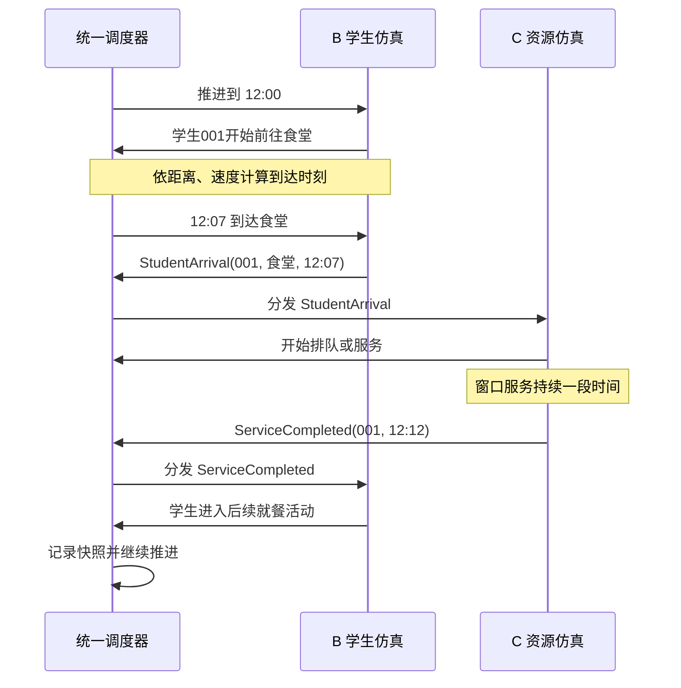

# CampusTwin Lite：系统架构与三人分工（v0.1）

> **项目定位**：基于个体行为的校园群体仿真与资源分析系统  
> **当前目标**：三人各自完成一个可独立运行、可独立测试的子系统，再集成为一个能跑通完整行为链的最小可运行产品（MVP）。  
> **架构原则**：统一时钟、清晰职责、事件交互、可逐步扩展。  
> **文档性质**：团队设计讨论与任务分配基准；接口细节需三人共同确认后冻结。

---

## 1. 项目究竟做什么

系统允许用户配置虚拟校园中的地点、道路距离、学生和资源条件，让学生根据日程和行为规则在校园中移动，在食堂等设施接受服务，最终输出**人流分布、移动时间、排队情况、设施利用率**等随时间变化的指标。

完成基本仿真后，用户还可以调整学生属性、道路或设施资源，重新运行并比较不同配置产生的结果。

**第一条必须跑通的行为链：**

```text
学生下课 → 选择目的地 → 沿路线移动 → 到达食堂
         → 排队等待 → 接受窗口服务 → 完成就餐 → 继续活动
```

这一过程的状态和时间需要由程序推演，**不能只是提前写好每个时刻的人数表并回放**。

**第一版不做**：图形地图、角色移动动画、联网、数据库、复杂 AI 决策、多交通网络、真实校园数据校准。

---

## 2. 总体架构



### 2.1 架构的四个角色

| 部分 | 负责的问题 | 责任归属 |
|---|---|---|
| **A：校园环境与场景管理** | 校园有什么？地点怎样连接？资源如何配置？ | 成员 A 的独立子系统 |
| **B：学生行为与移动仿真** | 学生什么时候做什么？从哪里移动到哪里？ | 成员 B 的独立子系统 |
| **C：公共资源服务仿真** | 学生到达后怎样排队、获得服务和离开？ | 成员 C 的独立子系统 |
| **公共仿真调度层** | 怎样让 B、C 处于同一时间轴，并交换事件？ | 三人共同制定协议；建议 A 实现薄调度层，三人共同集成验收 |

> **重要边界**：调度层只负责时间、事件派发和调用顺序；不能把 B 的行为决策或 C 的排队算法塞进调度层。它是公共基础设施，而不是第四个业务子系统。

### 2.2 一条核心架构原则

- **配置所有权**：A 管理地点、道路、资源静态参数及其持久化。
- **学生状态所有权**：B 管理学生位置、日程、移动和个人行为状态。
- **设施运行状态所有权**：C 管理排队队列、窗口忙闲与服务完成情况。
- **统一时间所有权**：只有公共调度器推进仿真时钟，避免三个子系统分别维护时间。
- **跨模块通信**：B、C 通过约定的事件或公开接口交换信息，不直接修改彼此私有状态。

---

## 3. 成员 A：校园环境与场景管理子系统

**定位**：定义、编辑、保存一个可以被其他子系统使用的虚拟校园。  
**难度**：中等；工程组织、数据一致性和文件处理工作较多。

### 3.1 要完成的功能

| 模块 | 具体内容 | 阶段 |
|---|---|---|
| 地点管理 | 创建、查询、修改、删除宿舍、教学楼、食堂、图书馆等地点 | MVP |
| 道路管理 | 创建道路、维护连接关系、录入距离 | MVP |
| 路径查询 | 根据道路关系返回可达性、路径距离（首版只需简单可用） | MVP |
| 资源配置 | 食堂窗口数、服务时长、地点容量等静态参数 | MVP |
| 场景读写 | 配置文件保存、加载、基础合法性校验 | MVP |
| 账号系统 | 注册、登录、用户名与密码管理、简单权限 | 课程硬性要求；MVP 核心仿真跑通后尽快补齐 |
| 控制台和调度层 | 统一菜单、启动仿真、公共事件分发的薄实现 | 集成任务 |

### 3.2 独立运行时能演示什么

```text
打开环境管理程序
  → 登录（账号功能完成后）
  → 创建 Campus_01
  → 添加教学楼、宿舍、食堂与图书馆
  → 设置地点连接、道路长度、食堂窗口数量
  → 查询「教学楼 A → 食堂」路径距离
  → 保存、退出、重新加载
```

### 3.3 对外交付

- **CampusScenario**：地点列表、道路连接、容量、设施配置；供 B 和 C 读取。
- **RouteInfo / 路径查询接口**：供 B 查询两地点之间的路线及距离。
- **样例场景数据**：保证 B、C 在 A 的界面完成前也能开发和测试。

**不负责**：学生何时出发、学生选择哪项活动、食堂排队和资源运行统计。

### 3.4 主要技术难点

1. **空间结构建模**：地点与道路形成图，不能只有一个地点名称列表；需要定义无路可达等边界情况。
2. **场景数据一致性**：道路不能连接不存在的地点；删除地点后如何处理依赖；容量和窗口参数必须合法。
3. **可扩展的数据组织**：以后增加地点或资源时，尽量不让下游模块依赖写死的地点名称。
4. **工程性任务较多**：账号、文件、菜单、调度层都需要明确归属，防止 A 在集成期负担失控。

### 3.5 A 的独立验收标准

- 能新建并编辑一个包含多地点及道路的校园场景。
- 能按要求查询地点间距离，并正确处理不可达情况。
- 保存后重启仍能恢复有效场景。
- 输出约定的场景数据，B/C 能直接消费，无须重写解析规则。

---

## 4. 成员 B：学生行为与移动仿真子系统

**定位**：使学生在统一时间轴上根据日程、环境和行为规则持续改变状态。  
**难度**：三个子系统中通常最高；难点集中在状态转换与跨模块协作。

### 4.1 要完成的功能

| 模块 | 具体内容 | 阶段 |
|---|---|---|
| 学生管理 | 创建学生并设置 ID、初始位置、移动速度等 | MVP |
| 日程管理 | 导入或设定上课、午餐、自由活动的基本日程 | MVP |
| 行为规则 | 当前状态结束后，按优先级决定下一项活动 | MVP（先用固定规则） |
| 移动模拟 | 结合 A 的路径距离和个人速度计算出行时间 | MVP |
| 状态转换 | 地点内、移动中、等待服务、接受服务、就餐等 | MVP |
| 到达事件 | 在到达设施时发出带学生和设施 ID 的事件 | MVP |
| 完成事件处理 | 接收 C 的完成通知，继续学生后续活动 | MVP |
| 骑行/偏好/动态选择 | 交通方式差异、根据拥堵调整目的地等 | 后续 |

### 4.2 独立运行时能演示什么

```text
读取一份固定校园场景
  → 创建 20 名学生，加载简单日程
  → 12:00 从教学楼出发
  → 按路径距离与速度计算不同的到达时刻
  → 向测试接收器发出到达事件
  → 使用模拟的“服务完成事件”继续后续活动
  → 输出所有学生的状态记录
```

### 4.3 对外接口

- **接收 A**：CampusScenario、路径与距离查询。
- **发给 C（经调度层）**：StudentArrival（学生到达某服务设施）。
- **接收 C（经调度层）**：ServiceCompleted（某学生完成服务）。
- **输出统计**：StudentSnapshot（时间、学生状态、当前位置或在途信息等）。

**不负责**：校园场景编辑、设施队列内部算法、食堂窗口运行。

### 4.4 主要技术难点

1. **状态机一致性**：学生不能一边移动、一边占据教学楼座位；在等待服务时不能直接执行冲突活动。
2. **时序与时间冲突**：学生排队耽误下一项活动时，必须有确定且可测试的优先级策略。
3. **大批学生状态更新**：避免重复处理事件、丢失到达事件、遗漏学生。
4. **B—C 反馈闭环**：学生进入设施后能否继续行动，取决于 C 的服务完成通知；接口必须稳定。

### 4.5 B 的独立验收标准

- 至少 20 名学生按照给定日程，从教学楼出发并在计算时刻到达食堂。
- 每个学生在任一时间只处于一个主要状态；同一学生不会被重复计入多个地点。
- 正确产生到达事件，接收到服务完成事件后才进入后续活动。
- 能导出便于检验的时间轴与状态日志。

---

## 5. 成员 C：公共资源服务与仿真分析子系统

**定位**：模拟设施如何接收学生、排队与提供服务，并产出资源运行指标。  
**难度**：中高；服务时序和资源状态正确性要求较高。

### 5.1 要完成的功能

| 模块 | 具体内容 | 阶段 |
|---|---|---|
| 食堂服务配置加载 | 读取窗口数量、服务时间等参数 | MVP |
| 到达与排队 | 接受 StudentArrival，按约定规则排队 | MVP |
| 多窗口服务 | 维护窗口忙闲、开始服务与完成时刻 | MVP |
| 服务完成事件 | 向 B（经调度层）返回 ServiceCompleted | MVP |
| 资源状态维护 | 队列长度、忙碌窗口数、完成服务人数 | MVP |
| 统计导出 | 最大队列、平均等待、各时刻资源状态 | MVP |
| 对照实验 | 改变窗口数/服务能力并比较不同运行结果 | MVP 稳定后优先扩展 |
| 其他设施规则 | 图书馆座位、体育馆容量及释放机制 | 后续 |

### 5.2 独立运行时能演示什么

```text
读取食堂配置
  → 输入一组测试到达事件（学生 001/002/003 ...）
  → 进入等待队列
  → 由空闲窗口按规则开始服务
  → 到服务完成时刻发出完成事件
  → 输出队列变化、窗口状态、等待时间和最大队列
```

### 5.3 对外接口

- **接收 A**：FacilityConfig（设施静态配置；可作为 CampusScenario 的组成部分）。
- **接收 B（经调度层）**：StudentArrival。
- **发给 B（经调度层）**：ServiceCompleted。
- **输出统计**：FacilitySnapshot（队列长度、窗口忙闲、服务人数、等待指标）。

**不负责**：学生路径选择、课程安排、学生整体行为状态和地图编辑。

### 5.4 主要技术难点

1. **队列与并行窗口**：避免同一学生被重复服务、窗口重复占用、学生长时间无法退出队列。
2. **精确的服务完成时序**：与统一时钟一致，明确同一时刻先处理完成还是新到达等执行顺序。
3. **事件返回与统计口径**：窗口服务完成、学生开始就餐、学生离开食堂不是同一个事件；指标必须定义清楚。
4. **可扩展服务机制**：未来图书馆座位分配与食堂窗口队列不同，不能强行复用不合适的算法。

### 5.5 C 的独立验收标准

- 不依赖 B，即可用预设到达事件跑通食堂服务过程。
- 任何时刻正在服务人数不超过窗口数，队列人数不为负。
- 每个有效请求只完成一次服务，产生正确的完成通知。
- 能输出可复核的服务日志与排队统计结果。

---

## 6. 公共调度层与子系统接口约定

### 6.1 为什么不能仅用 CSV 单向串联

`A 输出 CSV → B 输出人流 CSV → C 统计拥堵` 适合离线分析，但**C 的服务完成时刻会影响 B 的学生后续状态**，因此集成运行时必须有事件反馈。

CSV 仍可用于：**初始场景导入、独立测试输入、运行结果导出**；正式仿真中的互动则由同一进程内的接口与事件完成。

### 6.2 最小事件流



> 时间点为交互示例，不代表实测值。MVP 可使用 **1 分钟固定时间步**，并统一规定事件处理顺序、时长取整和同一时刻多事件的先后关系。

### 6.3 共享数据与事件契约

| 名称 | 提供 / 拥有 | 使用方 | 最小含义 |
|---|---|---|---|
| `CampusScenario` | A | B、C、调度层 | 地点、道路、容量、设施参数 |
| `RouteInfo` | A | B | 可达性、路径长度（可扩展路线） |
| `StudentArrival` | B | C（调度转发） | 学生 ID、设施 ID、到达时刻 |
| `ServiceCompleted` | C | B（调度转发） | 学生 ID、设施 ID、完成时刻 |
| `StudentSnapshot` | B | 结果记录器 | 学生位置、行为状态、当前时间 |
| `FacilitySnapshot` | C | 结果记录器 | 队列、窗口状态、资源统计 |

**接口冻结前应共同确认**：时间单位、地点/学生 ID 规则、状态和事件类型、同一时刻执行顺序、错误处理方式，以及“服务完成”和“就餐完成”的语义区别。

### 6.4 公共工作归属

| 工作 | 建议责任人 |
|---|---|
| 工程结构、编译入口、控制台菜单 | A |
| 薄调度层基础实现（只调度，不实现业务） | A |
| 学生状态更新、到达事件处理 | B |
| 资源服务、服务完成事件与分析 | C |
| 事件协议与模拟执行顺序 | 三人共同确认 |
| 系统集成与跨模块测试 | 三人共同验收 |

---

## 7. 第一轮 MVP：每人应交出什么

### 7.1 固定一个足够小的场景

**第一轮集成场景**：20 名学生、2 栋教学楼、1 间食堂、1 栋宿舍、1 座图书馆；只模拟一次“下课 → 移动 → 排队 → 服务 → 就餐/后续活动”的过程。完整一天和更丰富行为放到后续迭代。

| 成员 | 第一轮任务 | 交付给团队 | 独立完成标准 |
|---|---|---|---|
| **A** | 定义地点、道路及距离；建立食堂窗口配置；保存/读取场景 | 示例场景、路径距离查询、配置接口 | 能独立创建、加载场景；B 能查询路程 |
| **B** | 创建 20 名学生；按固定时间下课；计算移动；发出到达事件；维护状态 | 学生移动日志、到达事件 | 能独立模拟从教学楼出发到食堂的过程 |
| **C** | 建立 2 个食堂服务窗口；实现队列、服务完成、基础统计 | 服务完成事件、队列与等待日志 | 能独立用测试到达序列验证服务过程 |
| **全组** | 锁定契约，联调 A、B、C | 单一可运行程序 | 学生到达后由 C 服务，并反馈 B 继续活动 |

### 7.2 第一次集成验收（全部满足才算 MVP 闭环跑通）

- [ ] 可以加载一个含道路与食堂配置的校园场景。
- [ ] 20 名学生能按日程从教学楼出发。
- [ ] 出行时间由路线距离和学生速度决定。
- [ ] 学生到达食堂时触发服务请求，不会直接跳过排队。
- [ ] 服务窗口能按规则处理请求并发出完成事件。
- [ ] 学生收到服务完成事件后才进入后续活动。
- [ ] 可以查询或导出随时间变化的学生状态、设施队列和等待指标。
- [ ] 三个子系统都保留独立测试入口/示例，能各自演示其完整输入—处理—输出。

### 7.3 MVP 后的扩展路线

| 扩展功能 | 主要责任方 | 注意点 |
|---|---|---|
| 多食堂、多地点、道路变化 | A | 保持公共场景接口稳定 |
| 不同步行速度、骑车模式 | B | 扩展移动策略，不破坏时间模型 |
| 按食堂拥堵程度做目的地选择 | B + C | 需要暴露只读资源状态 |
| 图书馆座位、体育馆容量 | C | 设施服务规则可以不同 |
| 完整一天、多场景对照实验 | B + C，A 提供配置 | 在相同初始条件下比较结果 |
| 真实数据校准 | 全组（非课程 MVP 必需） | 区分模拟实验与真实世界预测 |

---

## 8. 工作量、风险与团队协作

以下是**相对难度的主观工程评估**，不是精确工时。

| 维度 | A 环境管理 | B 行为仿真 | C 资源服务 |
|---|---|---|---|
| 核心逻辑复杂度 | 中 | **高** | 中高 |
| 工程工作量 | 中高 | **高** | 中高 |
| 状态管理难度 | 低至中 | **高** | 中高 |
| 集成风险 | 中 | **高** | 中高 |
| 主要风险 | 数据不一致、集成任务过重 | 时间与状态冲突、事件处理复杂 | 队列时序错误、重复服务 |

**推荐的执行纪律：**

1. **先冻结最小接口，再并行开发**；不要三人各自创造一套 Student、Location 或时间定义。
2. **每人始终维护独立演示能力**，避免集成失败时无法验收个人子系统。
3. **先跑通第一条因果链，再增加功能**；不要在第一周加入复杂交通、自由行为、图形界面。
4. **每次提交都保留可运行测试**；跨模块接口变更先同步其他成员。
5. **周记记录实际证据**：做了什么、测试结果、遇到什么问题、如何修复、下周目标。

---

## 9. 与课程要求的对应关系

根据老师提供的《高级语言程序设计大作业》要求，特别需要满足：

- 三人各自完成一个子系统，再集成为一个统一应用程序。
- C++ 面向对象设计：类与对象、封装、继承、多态和多文件编程。
- 至少两层以上的类层次、文件数据处理、用户账号与密码管理。
- 每周周记、程序正确性、合理的类体系、测试、答辩和报告。
- 作业不允许直接以 AI 生成的完整成品代码作为学生作品提交。团队应独立实现并能够解释设计与代码。

本架构提供了子系统责任边界，但**具体继承/多态类体系**应由三位成员在实现各自子系统时依据真实差异设计，避免为了满足要求而创建无意义的继承层次。

---

## 10. 当前待团队确认的五项决策

- [ ] 谁承担 A、B、C？谁负责公共调度层的代码维护？
- [ ] 第一版采用 **1 分钟固定时间步**，还是其他粒度？
- [ ] 学生到达、服务完成、就餐完成的事件语义与顺序如何定义？
- [ ] 场景文件格式、地点 ID、学生 ID 如何统一？
- [ ] 第一轮联调截止时间和独立演示时间分别是什么时候？

**第一轮行动目标只有一个：让学生从教学楼出发，到食堂排队并完成服务，再继续下一项活动；全过程的时间和状态由程序计算出来。**
